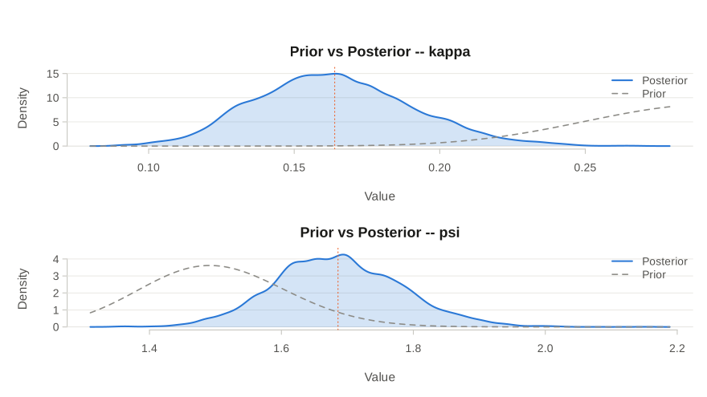
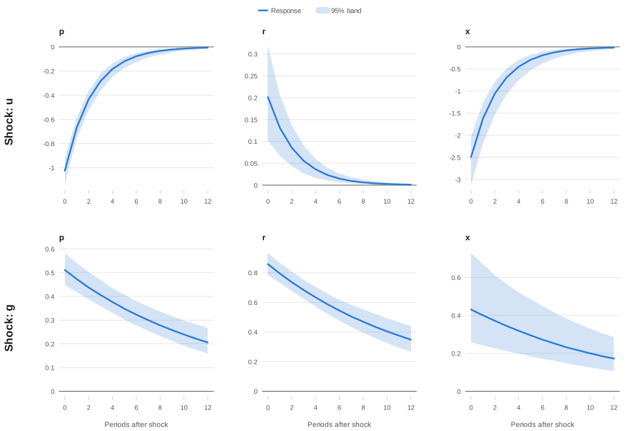
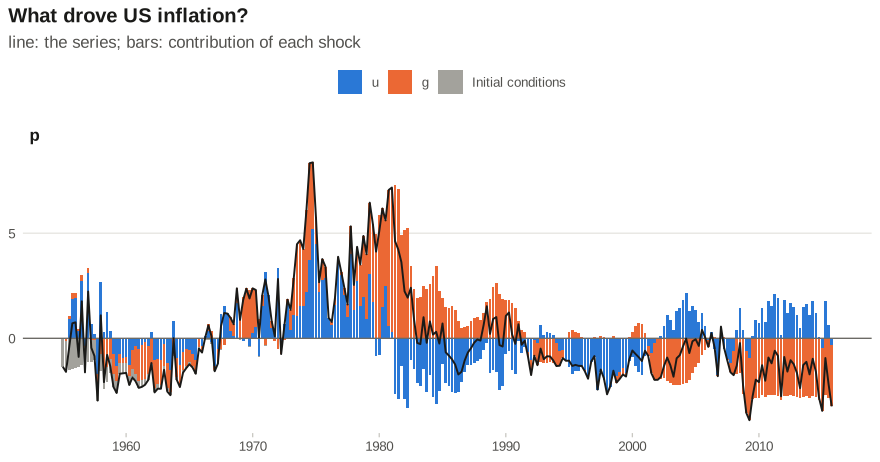
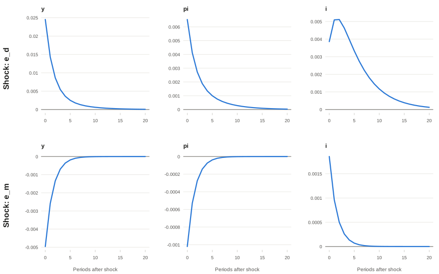

Dynamic stochastic general equilibrium (DSGE) models are the workhorse of
modern macroeconomics. Central banks and international institutions use them
to forecast, to work out which shocks have been driving inflation and output,
and to ask what would have happened under a different policy. Most people
build them in Dynare, which runs on MATLAB or Octave. If the rest of your work
is in R, that means moving your data into another language halfway through.

[dsge](https://CRAN.R-project.org/package=dsge) is an R package that covers
the whole job: write down a model, solve it, estimate it by maximum likelihood
or Bayesian methods, and then look at impulse responses, forecasts and shock
decompositions. There is no MATLAB or Octave involved. This post estimates a
small New Keynesian model on US data, then shows nonlinear models and
importing a Dynare file.


```r
install.packages("dsge")
```


```r
library(dsge)
```

## A three-equation New Keynesian model

The model has three equations:

- **Phillips curve.** Inflation `p` depends on expected inflation next quarter
  and on the output gap `x`.
- **IS curve.** The output gap depends on the expected output gap and on the
  real interest rate, and is pushed around by a demand shock `g`.
- **Taylor rule.** The central bank sets the interest rate `r` in response to
  inflation, plus a monetary policy shock `u`.

Both shocks follow AR(1) processes. In dsge each equation is an R formula.
`obs()` marks a variable we observe, `unobs()` one we do not, and `state()` an
exogenous state driven by a shock. `lead(p)` is the expectation of next
quarter's inflation.


```r
nk <- dsge_model(
  obs(p   ~ beta * lead(p) + kappa * x),     # Phillips curve
  unobs(x ~ lead(x) - (r - lead(p) - g)),    # IS curve
  obs(r   ~ psi * p + u),                    # Taylor rule
  state(u ~ rhou * u),                       # monetary policy shock
  state(g ~ rhog * g),                       # demand shock
  start = list(beta = 0.95, kappa = 0.15, psi = 1.5, rhou = 0.7, rhog = 0.9)
)
```

The output gap is never observed. The Kalman filter infers it from the path
of inflation and the interest rate.

## The data

We need two quarterly series from [FRED](https://fred.stlouisfed.org/):
inflation, computed from the GDP deflator, and the federal funds rate. FRED
serves any series as a CSV file, so base R is enough to download them.


```r
get_fred <- function(id, start, end) {
  url <- paste0("https://fred.stlouisfed.org/graph/fredgraph.csv?id=", id,
                "&cosd=", start, "&coed=", end, "&fq=Quarterly&fam=avg")
  x <- read.csv(url)
  data.frame(date = as.Date(x[[1]]), value = as.numeric(x[[2]]))
}

deflator <- get_fred("GDPDEF",   "1954-10-01", "2015-12-31")
fedfunds <- get_fred("FEDFUNDS", "1955-01-01", "2015-12-31")

us <- data.frame(date = deflator$date[-1],
                 p = 400 * diff(log(deflator$value)))  # annualised inflation
us$r <- fedfunds$value[match(us$date, fedfunds$date)]
range(us$date)
#> [1] "1955-01-01" "2015-10-01"
```

That gives 244 quarters, from 1955 to 2015. dsge subtracts the sample means
before estimation, so the model describes deviations from average inflation
and the average interest rate.

## Bayesian estimation

Priors are set with `prior()`. These say that households are patient (`beta`
close to 1), that the Phillips curve is fairly flat (`kappa` small), that the
Fed responds more than one for one to inflation (`psi` around 1.5), and that
both shocks are persistent. The standard deviations of the shocks get a
diffuse inverse-gamma prior by default.


```r
priors <- list(
  beta  = prior("beta",  shape1 = 95,  shape2 = 5),
  kappa = prior("beta",  shape1 = 30,  shape2 = 70),
  psi   = prior("gamma", shape  = 184, rate   = 122.7),
  rhou  = prior("beta",  shape1 = 70,  shape2 = 20),
  rhog  = prior("beta",  shape1 = 70,  shape2 = 20)
)
```

`bayes_dsge()` samples the posterior with an adaptive random-walk
Metropolis-Hastings algorithm. Four chains of 10,000 draws take about a
minute on a laptop.


```r
fit <- bayes_dsge(nk, data = us[, c("p", "r")], priors = priors,
                  chains = 4, iter = 10000, warmup = 5000, seed = 1)
summary(fit)
#> Bayesian DSGE estimation (RWMH, linear)
#>   Chains: 4  Iterations: 10000  Warmup: 5000 
#>   Observations: 244 
#>   Acceptance rates: 0.235, 0.277, 0.252, 0.223 
#> 
#> Posterior summary:
#>          mean     sd   2.5%    50%  97.5%   ess   rhat   mcse
#> beta   0.9336 0.0275 0.8703 0.9368 0.9762 727.0 1.0050 0.0010
#> kappa  0.1639 0.0269 0.1160 0.1628 0.2202 825.4 1.0058 0.0009
#> psi    1.6858 0.0964 1.5045 1.6830 1.8829 838.4 1.0021 0.0033
#> rhou   0.6503 0.0248 0.6033 0.6499 0.6991 857.8 1.0068 0.0008
#> rhog   0.9260 0.0111 0.9036 0.9264 0.9468 854.3 1.0038 0.0004
#> sd_e.u 1.9361 0.1265 1.7025 1.9330 2.2022 813.1 1.0043 0.0044
#> sd_e.g 0.4195 0.0374 0.3472 0.4196 0.4936 963.4 1.0014 0.0012
```

The summary reports effective sample sizes (`ess`), the Gelman-Rubin
statistic (`rhat`) and the Monte Carlo standard error of each posterior mean
(`mcse`). Values of `rhat` close to 1 mean the four chains agree.

Some results:

- The estimated Taylor-rule coefficient `psi` is about
  1.69, above 1: the Fed raised the nominal rate by
  more than the rise in inflation, so the real rate went up. This is the
  Taylor principle.
- Demand shocks are more persistent than monetary policy shocks (`rhog` is
  about 0.93 against 0.65
  for `rhou`).

Comparing prior and posterior shows how much the data have to say. The data
pull the slope of the Phillips curve, `kappa`, well below its prior mean of
0.3, and push `psi` above its prior mean of 1.5:


```r
plot(fit, type = "prior_posterior", pars = c("kappa", "psi"))
```



Leave out `pars` to see every parameter. `plot()` also draws trace plots
(`type = "trace"`), autocorrelations (`"acf"`) and pairwise scatter plots of
the draws (`"pairs"`).

## Impulse responses

What happens after a monetary tightening, or a jump in demand? `irf()`
computes the responses at 500 posterior draws, and the plot shows the median
response with credible bands.


```r
irfs <- irf(fit, periods = 12, n_draws = 500)
plot(irfs, response = c("p", "r", "x"))
```



A positive monetary policy shock (`u`) raises the interest rate, and the
output gap and inflation fall. A positive demand shock (`g`) raises the output
gap and inflation, and the Fed responds by raising the rate.

## What drove US inflation?

`shock_decomposition()` uses the Kalman smoother to split each observed
series, quarter by quarter, into the contributions of the two shocks, with
the parameters at their posterior means. `plot(hd)` draws it with base
graphics. If you use ggplot2, `autoplot()` returns a ggplot that you can
modify, here to label the axis with years instead of quarter numbers:


```r
hd <- shock_decomposition(fit)

library(ggplot2)
decades <- seq(1960, 2010, by = 10)
autoplot(hd, which = "p") +
  scale_x_continuous(breaks = (decades - 1955) * 4 + 1, labels = decades) +
  labs(title = "What drove US inflation?", x = NULL)
```




The model's reading of US history:

- **1973 to 1980:** inflation was well above average, and the two shocks
  share the blame about equally. Monetary policy shocks (`u`) added
  1.9 points on average and demand shocks (`g`)
  2.3 points. Monetary shocks push inflation up when interest
  rates are lower than the Taylor rule would set.
- **1981 to 1984:** the monetary shocks turn negative and take
  2.1 points off inflation, while demand is still adding
  3.9. This is the Volcker disinflation.
- **2008 to 2015:** weak demand holds inflation 2.7 points below
  average.

It is a small model with two shocks, so take this as an illustration rather
than a verdict. It also ignores the zero lower bound on interest rates after
2008. dsge can handle constraints like that with `simulate_occbin()`.

## Nonlinear models

Linear models cover a lot of ground, but some questions need the nonlinear
equations: risk, precautionary saving, or responses that depend on the size
and sign of a shock. `dsgenl_model()` takes the equations as strings, with
`C(+1)` for next period's consumption. Here is a real business cycle model
with capital `K` and technology `Z`:


```r
rbc <- dsgenl_model(
  "1/C = beta / C(+1) * (alpha * exp(Z) * K^(alpha - 1) + 1 - delta)",
  "K(+1) = exp(Z) * K^alpha - C + (1 - delta) * K",
  "Z(+1) = rho * Z",
  observed = "C", endo_state = "K", exo_state = "Z",
  fixed = list(alpha = 0.33, beta = 0.99, delta = 0.025),
  start = list(rho = 0.9),
  ss_guess = c(C = 2, K = 30, Z = 0)
)

params <- c(alpha = 0.33, beta = 0.99, delta = 0.025, rho = 0.9)
steady_state(rbc, params = params)
#> Deterministic Steady State
#>   Converged: TRUE  ( 5  iterations)
#>   Max residual: 5.551e-17 
#> 
#>   Values:
#>      C = 2.306617 
#>      Z = 0 
#>      K = 28.34842
```

`solve_dsge()` finds the steady state, linearises around it and solves the
model. With `order = 2` it keeps the second-order terms of the decision
rules, so a large negative shock no longer has the mirror-image effect of a
large positive one:


```r
sol2 <- solve_dsge(rbc, params = params, shock_sd = c(Z = 0.01), order = 2)

# Responses to technology shocks of plus and minus five standard deviations
up   <- irf_2nd_order(sol2, shock = "Z", size =  5, periods = 40)
down <- irf_2nd_order(sol2, shock = "Z", size = -5, periods = 40)

# Consumption on impact: it rises by more than it falls
c(up   = up$response[up$variable == "C"][1],
  down = down$response[down$variable == "C"][1])
#>          up        down 
#>  0.02285049 -0.02228800
```

`plot(up)` draws the second-order responses.

Third-order solutions (`order = 3`), the particle filter for estimating
nonlinear models (`bayes_particle()`), perfect-foresight paths and
occasionally binding constraints such as the zero lower bound
(`simulate_occbin()`) are also available.

## Bringing your Dynare files

Many published models come as Dynare `.mod` files. `read_dynare()` reads
them, along with their calibration, shocks, priors and estimation settings.
The result goes straight into `solve_dsge()`, `irf()` and the estimation
functions. It takes a file path or, as here, the model code as text:


```r
mod <- read_dynare(text = "
  var y pi i u;
  varexo e_d e_m;
  parameters beta sigma kappa phi_pi phi_y rho_i rho_u;
  beta = 0.99; sigma = 1; kappa = 0.1;
  phi_pi = 1.5; phi_y = 0.125; rho_i = 0.7; rho_u = 0.8;
  model(linear);
    y  = y(+1) - 1/sigma * (i - pi(+1)) + u;
    pi = beta * pi(+1) + kappa * y;
    i  = rho_i * i(-1) + (1 - rho_i) * (phi_pi * pi + phi_y * y) + e_m;
    u  = rho_u * u(-1) + e_d;
  end;
  shocks;
    var e_d; stderr 0.01;
    var e_m; stderr 0.0025;
  end;
")
plot(irf(solve_dsge(mod), periods = 20, se = FALSE),
     response = c("y", "pi", "i"))
```



How close is it to Dynare? For the Smets and Wouters (2007) model, the
log-likelihood computed by dsge matches Dynare's to nine decimal places.

## What else is in the package

- Maximum likelihood estimation with `estimate()`, with standard and robust
  standard errors
- Sequential Monte Carlo (`bayes_smc()`), DSGE-VARs, and model comparison with
  Bayes factors (`bayes_factor()`)
- Forecasts and conditional forecasts (`forecast()`,
  `conditional_forecast()`)
- Variance decompositions, smoothed states and shocks
- Identification and sensitivity diagnostics (`check_identification()`,
  `parameter_sensitivity()`)
- Optimal policy: Ramsey, discretion and optimal simple rules
- `autoplot()` methods for ggplot2 users, and `model_latex()` to write a
  model's equations in LaTeX

## Learn more

- CRAN: <https://CRAN.R-project.org/package=dsge>
- Source code and issues: <https://github.com/Mustapha-Wasseja/dsge-package>
- A longer walkthrough is in the package vignette:
  `vignette("introduction", package = "dsge")`

Bug reports, feature requests and models that do not work are all welcome
on GitHub.
