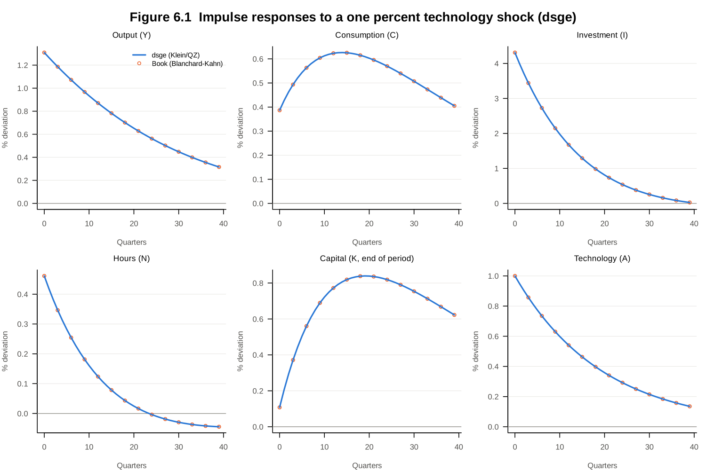
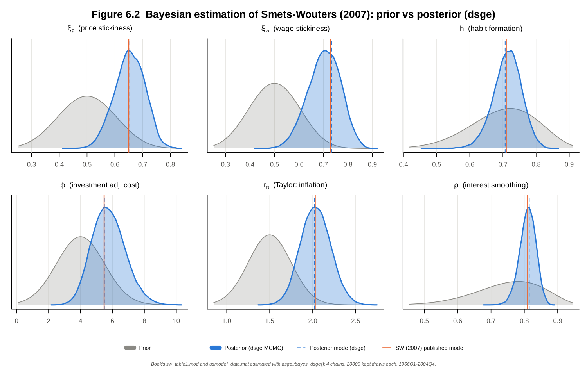

# Paccagnini, *Macroeconometrics*, Chapter 6 (DSGE models) with dsge

Companion code: <https://github.com/AlessiaPaccagnini/Macroeconometrics_book>
(De Gruyter, forthcoming). Chapter 6 is the book's only DSGE chapter. Its
model-based examples are run here with dsge, in R, without Dynare or MATLAB.

| Book item | Book code | What it computes | Here |
|---|---|---|---|
| Table 6.1 | `Codes_Figures/chapter6_dsge_companion.R`, Section 1 | HP-filtered business-cycle moments of US data | not a DSGE model; nothing for dsge to do |
| Figure 6.1 | same file, Section 2 | RBC impulse responses, hand-derived log-linearisation solved by Blanchard-Kahn | `ch6_figure_6_1_rbc_irf.R` |
| Figure 6.2 | same file, Section 3 | prior vs posterior for six SW (2007) parameters, drawn as normal approximations around the published mode and 90% interval | `ch6_smets_wouters_estimation.R` (from an actual estimation) |
| Empirical example | `Codes_Empirical_Examples/sw_table1.mod` (+ 3 included `.mod` files), `usmodel_data.mat`, `table1.m` | Bayesian estimation of Smets-Wouters (2007) in Dynare; Tables 1A and 1B | `ch6_smets_wouters_estimation.R` |

The book's "Extra Code" folder only links to an external MATLAB toolbox
(DSGE-SVt), so there is nothing there to run.

## Running

The book's files are not copied here (the book repository has no licence
file). Point `MACRO_BOOK_DIR` at a clone, or leave it unset and the scripts
clone the repository into a temporary directory.

```bash
export MACRO_BOOK_DIR=/path/to/Macroeconometrics_book
Rscript dev/macroeconometrics-book/ch6_figure_6_1_rbc_irf.R
Rscript dev/macroeconometrics-book/ch6_smets_wouters_estimation.R
```

The estimation needs `R.matlab` (to read `usmodel_data.mat`). Its posterior
mode and draws are cached in `output/*.rds` (not committed), so a re-run only
redraws the tables and figures; set `SW_REFIT_MODE=1` / `SW_REFIT_MCMC=1` to
recompute. The chain length is set with `SW_CHAINS`, `SW_ITER`, `SW_WARMUP`,
`SW_THIN`, `SW_CORES` and `SW_SEED` (defaults: 4 chains x 150000 iterations,
50000 warm-up, thin 5, about 1 hour on 4 cores).

## Results

### Figure 6.1: RBC impulse responses

`ch6_figure_6_1_rbc_irf.R` writes the nonlinear model once, with all
variables in logs, using `dsgenl_model()` (log utility in consumption, `N^(1+eta)/(1+eta)`
disutility of work, Cobb-Douglas output, `k(+1)` capital timing) and lets
dsge find the steady state, linearise and solve it. The book's own
functions are then loaded from its script (definitions only) and run on
the same calibration.

- Steady state: Y = 2.8220, C = 2.1587, I = 0.6633, K = 26.5305,
  N = 0.9359 in both.
- Impact responses (%): Y 1.309, C 0.387, I 4.311, N 0.461, K (end of
  period) 0.108; consumption peaks at 0.626 in quarter 14, capital at
  0.840 in quarter 19.
- Largest difference from the book's Blanchard-Kahn solution, over all
  six variables and 40 quarters: **3.2e-13**.



### Smets-Wouters (2007): the book's Dynare example

`read_dynare()` imports `sw_table1.mod` and its three included files
unchanged: 40 endogenous variables, 7 shocks, 36 estimated parameters
with their priors, and the estimation options `first_obs = 71`,
`presample = 4`, `lik_init = 2`, `prefilter = 0`. The likelihood runs
from 1966Q1 to 2004Q4 (156 quarters).

**Posterior mode.** Maximising log-likelihood + log-prior within the
`estimated_params` bounds from the file's initial values (L-BFGS-B, the
counterpart of the file's `mode_compute = 1`) takes 6 minutes on 4 cores:
log-likelihood -817.44, log-prior -23.64, log posterior -841.08. For the
six parameters of the book's Figure 6.2 it reproduces the published
Smets-Wouters mode (values read from the book's figure script):

| Parameter | SW (2007) mode | dsge mode | SW 90% interval | dsge 90% HPD |
|---|---:|---:|---|---|
| xi_p (price stickiness) | 0.65 | 0.654 | [0.56, 0.74] | [0.567, 0.743] |
| xi_w (wage stickiness) | 0.73 | 0.734 | [0.60, 0.81] | [0.593, 0.809] |
| h (habit) | 0.71 | 0.707 | [0.64, 0.78] | [0.646, 0.785] |
| phi (investment adj. cost) | 5.48 | 5.493 | [3.97, 7.42] | [3.998, 7.373] |
| r_pi (Taylor: inflation) | 2.03 | 2.022 | [1.74, 2.33] | [1.753, 2.321] |
| rho (interest smoothing) | 0.81 | 0.815 | [0.77, 0.85] | [0.770, 0.850] |

**MCMC.** `bayes_dsge()` with 4 chains of 150,000 iterations (50,000
warm-up, every 5th draw kept: 80,000 draws), started at the mode, took 62
minutes on 4 cores. Acceptance rates 0.18-0.25. The four chains agree:
mean log posterior -859.4 to -859.7, and the same means for the
parameters that separate the minor mode below (`rho_a` 0.956-0.958,
`rho_b` 0.220-0.223, `gamma_bar` 0.430-0.432). **R-hat is at most 1.010
for all 36 parameters**, and the effective sample size ranges from 754
to 1826 (median 1347).

Two shorter runs came first, and their logs are kept in `output/`.
Random-walk MH mixes slowly on this posterior (autocorrelation times of
several hundred draws), and the file's 2 x 2,000 draws would be far too
few:

- 4 x 30,000 iterations (`ch6_smets_wouters_estimation_30k_unconverged.log`):
  one chain settled in a minor mode with productivity close to a unit
  root (`rho_a` 0.99, `rho_b` 0.64, `gamma_bar` 0.36), whose log
  posterior is about 10 points below the main mode. The other three still
  had R-hat up to 1.23.
- 4 x 125,000 iterations with 25,000 warm-up
  (`ch6_smets_wouters_estimation_125k.log`): all chains in the main mode,
  but one was still settling in the wage block (`rho_w` and `xi_w`, which
  trade off against each other), leaving R-hat at 1.21 and 1.13 for those
  two. Doubling the warm-up removed this.

#### Table 1A: structural parameters (5% / 95%: 90% HPD interval, as in `table1.m`)

| Parameter | Prior | Mode | Mean | 5% | 95% | R-hat | ESS |
|---|---|---:|---:|---:|---:|---:|---:|
| phi (investment adj. cost) | N(4, 1.5) | 5.493 | 5.769 | 3.998 | 7.373 | 1.008 | 1175 |
| sigma_c (risk aversion) | N(1.5, 0.375) | 1.421 | 1.383 | 1.165 | 1.592 | 1.002 | 1240 |
| h (habit) | B(0.7, 0.1) | 0.707 | 0.714 | 0.646 | 0.785 | 1.003 | 1549 |
| xi_w (wage Calvo) | B(0.5, 0.1) | 0.734 | 0.703 | 0.593 | 0.809 | 1.001 | 976 |
| sigma_l (labour supply elast.) | N(2, 0.75) | 1.880 | 1.845 | 0.906 | 2.779 | 1.002 | 1437 |
| xi_p (price Calvo) | B(0.5, 0.1) | 0.654 | 0.653 | 0.567 | 0.743 | 1.010 | 754 |
| iota_w (wage indexation) | B(0.5, 0.15) | 0.598 | 0.581 | 0.378 | 0.785 | 1.005 | 1214 |
| iota_p (price indexation) | B(0.5, 0.15) | 0.218 | 0.241 | 0.095 | 0.380 | 1.002 | 1649 |
| psi (capital utilisation) | B(0.5, 0.15) | 0.545 | 0.547 | 0.358 | 0.731 | 1.003 | 1226 |
| Phi (fixed cost) | N(1.25, 0.125) | 1.610 | 1.607 | 1.477 | 1.730 | 1.003 | 1777 |
| r_pi (Taylor: inflation) | N(1.5, 0.25) | 2.022 | 2.036 | 1.753 | 2.321 | 1.004 | 1403 |
| rho (interest smoothing) | B(0.75, 0.1) | 0.815 | 0.810 | 0.770 | 0.850 | 1.003 | 1171 |
| r_y (Taylor: output gap) | N(0.125, 0.05) | 0.088 | 0.088 | 0.049 | 0.123 | 1.002 | 1399 |
| r_dy (Taylor: d output gap) | N(0.125, 0.05) | 0.222 | 0.224 | 0.178 | 0.270 | 1.002 | 1349 |
| pi_bar (SS inflation) | G(0.625, 0.1) | 0.764 | 0.787 | 0.604 | 0.957 | 1.003 | 1203 |
| 100(1/beta - 1) | G(0.25, 0.1) | 0.145 | 0.167 | 0.074 | 0.254 | 1.003 | 1425 |
| l_bar (SS hours) | N(0, 2) | 0.736 | 0.506 | -1.240 | 2.356 | 1.003 | 1400 |
| gamma_bar (trend growth) | N(0.4, 0.1) | 0.434 | 0.431 | 0.406 | 0.455 | 1.002 | 1449 |
| alpha (capital share) | N(0.3, 0.05) | 0.191 | 0.190 | 0.161 | 0.220 | 1.004 | 1374 |

#### Table 1B: shock processes

| Parameter | Prior | Mode | Mean | 5% | 95% | R-hat | ESS |
|---|---|---:|---:|---:|---:|---:|---:|
| sigma_a (productivity) | IG(0.1, 2) | 0.453 | 0.458 | 0.411 | 0.504 | 1.005 | 1279 |
| sigma_b (risk premium) | IG(0.1, 2) | 0.242 | 0.239 | 0.200 | 0.279 | 1.002 | 1427 |
| sigma_g (exogenous spending) | IG(0.1, 2) | 0.521 | 0.529 | 0.479 | 0.581 | 1.002 | 1252 |
| sigma_i (investment) | IG(0.1, 2) | 0.455 | 0.451 | 0.368 | 0.532 | 1.002 | 1346 |
| sigma_r (monetary policy) | IG(0.1, 2) | 0.239 | 0.244 | 0.219 | 0.268 | 1.002 | 1448 |
| sigma_p (price mark-up) | IG(0.1, 2) | 0.140 | 0.140 | 0.112 | 0.169 | 1.003 | 1224 |
| sigma_w (wage mark-up) | IG(0.1, 2) | 0.247 | 0.243 | 0.205 | 0.280 | 1.001 | 1247 |
| rho_a | B(0.5, 0.2) | 0.961 | 0.957 | 0.938 | 0.976 | 1.001 | 1575 |
| rho_b | B(0.5, 0.2) | 0.183 | 0.222 | 0.078 | 0.369 | 1.002 | 1026 |
| rho_g | B(0.5, 0.2) | 0.976 | 0.977 | 0.963 | 0.990 | 1.004 | 1141 |
| rho_i | B(0.5, 0.2) | 0.703 | 0.713 | 0.617 | 0.813 | 1.001 | 1406 |
| rho_r | B(0.5, 0.2) | 0.123 | 0.150 | 0.045 | 0.246 | 1.003 | 1826 |
| rho_p | B(0.5, 0.2) | 0.908 | 0.887 | 0.812 | 0.968 | 1.004 | 799 |
| rho_w | B(0.5, 0.2) | 0.974 | 0.967 | 0.946 | 0.989 | 1.001 | 912 |
| mu_p | B(0.5, 0.2) | 0.744 | 0.693 | 0.532 | 0.858 | 1.002 | 1061 |
| mu_w | B(0.5, 0.2) | 0.893 | 0.842 | 0.749 | 0.938 | 1.001 | 1428 |
| rho_ga | N(0.5, 0.25) | 0.523 | 0.521 | 0.374 | 0.664 | 1.005 | 1446 |

The tables are also in `output/table_1a_structural.csv` and
`output/table_1b_shocks.csv`; the full run is in
`output/ch6_smets_wouters_estimation.log`.

### Figure 6.2: prior vs posterior

The book's figure draws a normal approximation around the published
mode and 90% interval. Here the posterior is the density of the MCMC
draws, the prior is the one in `sw_estimation_def.mod`, and the published
mode is marked for comparison. `output/sw_prior_posterior_all.pdf` shows
all 36 parameters with the package's own `plot(fit, type = "prior_posterior")`.



### Differences from the Dynare run

- **Mode search:** L-BFGS-B within the bounds instead of MATLAB's
  `fmincon` active-set algorithm. It starts from the same values and
  stays within the same bounds.
- **Sampler:** `bayes_dsge()`'s adaptive random-walk MH (proposal tuned
  during warm-up, in an unconstrained parameterisation) instead of
  Dynare's fixed-scale RWMH with `mh_jscale = 0.2`, and far longer chains.
- **Bounds:** `read_dynare()` records the `estimated_params` bounds but
  `bayes_dsge()` does not truncate the posterior at them. 0.22% of the
  `xi_p` draws fall below 0.5, and 0.02% of the `rho_r` and `sigma_l`
  draws cross their bounds; all other parameters stay inside.
- **`table1.m`:** the book's script lists `eta_r` twice and fills the
  "mean" column of the shock standard deviations with the mode. The
  tables here do not repeat either slip.
