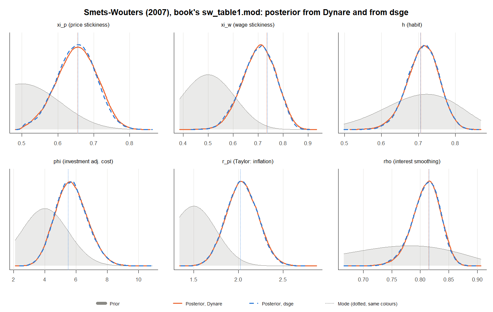

# Paccagnini, *Macroeconometrics*, Chapter 6 (DSGE models) with dsge

Companion code: <https://github.com/AlessiaPaccagnini/Macroeconometrics_book>
(De Gruyter, forthcoming). Chapter 6 is the book's only DSGE chapter. Its
model-based examples are run here with dsge, in R, without Dynare or MATLAB.
The Smets-Wouters estimation is then checked against Dynare 7.0 estimating
the same file in MATLAB and in Octave (`ch6_compare_dynare.R`).

| Book item | Book code | What it computes | Here |
|---|---|---|---|
| Table 6.1 | `Codes_Figures/chapter6_dsge_companion.R`, Section 1 | HP-filtered business-cycle moments of US data | not a DSGE model; nothing for dsge to do |
| Figure 6.1 | same file, Section 2 | RBC impulse responses, hand-derived log-linearisation solved by Blanchard-Kahn | `ch6_figure_6_1_rbc_irf.R` |
| Figure 6.2 | same file, Section 3 | prior vs posterior for six SW (2007) parameters, drawn as normal approximations around the published mode and 90% interval | `ch6_smets_wouters_estimation.R` (from an actual estimation) |
| Empirical example | `Codes_Empirical_Examples/sw_table1.mod` (+ 3 included `.mod` files), `usmodel_data.mat`, `table1.m` | Bayesian estimation of Smets-Wouters (2007) in Dynare; Tables 1A and 1B | `ch6_smets_wouters_estimation.R` |

The book's "Extra Code" folder only links to an external MATLAB toolbox
(DSGE-SVt), so there is nothing there to run.

## Running

The book's files are not copied here (the book repository has no licence
file). Point `MACRO_BOOK_DIR` at a clone, or leave it unset and the scripts
clone the repository into a temporary directory.

```bash
export MACRO_BOOK_DIR=/path/to/Macroeconometrics_book
Rscript dev/macroeconometrics-book/ch6_figure_6_1_rbc_irf.R
Rscript dev/macroeconometrics-book/ch6_smets_wouters_estimation.R
Rscript dev/macroeconometrics-book/ch6_compare_sw_mode.R
Rscript dev/macroeconometrics-book/ch6_compare_dynare.R   # needs Dynare's runs, see below
```

On Windows the mode search's gradient runs serially (`mclapply` cannot
fork there), and `bayes_dsge()` runs its chains on PSOCK workers, which
load the *installed* dsge: install this branch first (or put its library
first in `R_LIBS`).

The estimation needs `R.matlab` (to read `usmodel_data.mat`). Its posterior
mode and draws are cached in `output/*.rds` (not committed), so a re-run only
redraws the tables and figures; set `SW_REFIT_MODE=1` / `SW_REFIT_MCMC=1` to
recompute. The chain length is set with `SW_CHAINS`, `SW_ITER`, `SW_WARMUP`,
`SW_THIN`, `SW_CORES` and `SW_SEED` (defaults: 4 chains x 150000 iterations,
50000 warm-up, thin 5, about 1 hour on 4 cores).

`ch6_compare_sw_mode.R` uses the estimation's cached mode and draws. It
reads Smets and Wouters' mode file from Johannes Pfeifer's DSGE_mod
repository: point `PFEIFER_DSGE_MOD_DIR` at a clone, or leave it unset and
the script clones the `Smets_Wouters_2007` folder into a temporary
directory. Its mode-search restart takes a few minutes on 4 cores (set
`SW_SKIP_RESTART=1` to skip it).

## Results

### Figure 6.1: RBC impulse responses

`ch6_figure_6_1_rbc_irf.R` writes the nonlinear model once, with all
variables in logs, using `dsgenl_model()` (log utility in consumption, `N^(1+eta)/(1+eta)`
disutility of work, Cobb-Douglas output, `k(+1)` capital timing) and lets
dsge find the steady state, linearise and solve it. The book's own
functions are then loaded from its script (definitions only) and run on
the same calibration.

- Steady state: Y = 2.8220, C = 2.1587, I = 0.6633, K = 26.5305,
  N = 0.9359 in both.
- Impact responses (%): Y 1.309, C 0.387, I 4.311, N 0.461, K (end of
  period) 0.108; consumption peaks at 0.626 in quarter 14, capital at
  0.840 in quarter 19.
- Largest difference from the book's Blanchard-Kahn solution, over all
  six variables and 40 quarters: **3.2e-13**.


### Smets-Wouters (2007): the book's Dynare example

`read_dynare()` imports `sw_table1.mod` and its three included files
unchanged: 40 endogenous variables, 7 shocks, 36 estimated parameters
with their priors, and the estimation options `first_obs = 71`,
`presample = 4`, `lik_init = 2`, `prefilter = 0`. The likelihood runs
from 1966Q1 to 2004Q4 (156 quarters).

**Posterior mode.** Maximising log-likelihood + log-prior within the
`estimated_params` bounds from the file's initial values (L-BFGS-B, the
counterpart of the file's `mode_compute = 1`) takes 6 minutes on 4 cores:
log-likelihood -817.44, log-prior -23.64, log posterior -841.08. For the
six parameters of the book's Figure 6.2 it reproduces the published
Smets-Wouters mode (values read from the book's figure script):

| Parameter | SW (2007) mode | dsge mode | SW 90% interval | dsge 90% HPD |
|---|---:|---:|---|---|
| xi_p (price stickiness) | 0.65 | 0.654 | [0.56, 0.74] | [0.561, 0.739] |
| xi_w (wage stickiness) | 0.73 | 0.734 | [0.60, 0.81] | [0.595, 0.811] |
| h (habit) | 0.71 | 0.707 | [0.64, 0.78] | [0.643, 0.782] |
| phi (investment adj. cost) | 5.48 | 5.493 | [3.97, 7.42] | [3.993, 7.382] |
| r_pi (Taylor: inflation) | 2.03 | 2.022 | [1.74, 2.33] | [1.746, 2.314] |
| rho (interest smoothing) | 0.81 | 0.815 | [0.77, 0.85] | [0.768, 0.850] |

**MCMC.** `bayes_dsge()` with 4 chains of 150,000 iterations (50,000
warm-up, every 5th draw kept: 80,000 draws), started at the mode and
kept within the file's `estimated_params` bounds, took 62 minutes on 4
cores. Acceptance rates 0.22-0.26. The four chains agree: mean log
posterior -859.3 to -860.1, and the same means for the parameters that
separate the minor mode below (`rho_a` 0.957-0.958, `rho_b` 0.215-0.232,
`gamma_bar` 0.430-0.432). **R-hat is at most 1.004 for all 36
parameters**, the effective sample size ranges from 1191 to 2825 (median
2375), and every draw lies within the bounds.

Three earlier runs came first, and their logs are kept in `output/`.
Random-walk MH mixes slowly on this posterior (autocorrelation times of
several hundred draws), and the file's 2 x 2,000 draws would be far too
few:

- 4 x 30,000 iterations (`ch6_smets_wouters_estimation_30k_unconverged.log`):
  one chain settled in a minor mode with productivity close to a unit
  root (`rho_a` 0.99, `rho_b` 0.64, `gamma_bar` 0.36), whose log
  posterior is about 10 points below the main mode. The other three still
  had R-hat up to 1.23.
- 4 x 125,000 iterations with 25,000 warm-up
  (`ch6_smets_wouters_estimation_125k.log`): all chains in the main mode,
  but one was still settling in the wage block (`rho_w` and `xi_w`, which
  trade off against each other), leaving R-hat at 1.21 and 1.13 for those
  two. Doubling the warm-up removed this.
- 4 x 150,000 iterations with 50,000 warm-up, before `bayes_dsge()`
  enforced the bounds (`ch6_smets_wouters_estimation_150k_unbounded.log`):
  converged (R-hat at most 1.010, ESS 754-1826), but 0.22% of the `xi_p`
  draws fell below its lower bound of 0.5, and 0.02% of the `rho_r` and
  `sigma_l` draws crossed theirs. Enforcing the bounds changed posterior
  means and interval ends by at most 0.05 (the mean of `phi`, the upper
  end for `sigma_l`) and by 0.01 or less for 33 of the 36 parameters,
  differences of the size of the Monte Carlo error (for `xi_p`: mean
  0.653 to 0.650, interval [0.567, 0.743] to [0.561, 0.739]).

#### Table 1A: structural parameters (5% / 95%: 90% HPD interval, as in `table1.m`)

| Parameter | Prior | Mode | Mean | 5% | 95% | R-hat | ESS |
|---|---|---:|---:|---:|---:|---:|---:|
| phi (investment adj. cost) | N(4, 1.5) | 5.493 | 5.722 | 3.993 | 7.382 | 1.004 | 2556 |
| sigma_c (risk aversion) | N(1.5, 0.375) | 1.421 | 1.383 | 1.164 | 1.597 | 1.002 | 2075 |
| h (habit) | B(0.7, 0.1) | 0.707 | 0.713 | 0.643 | 0.782 | 1.003 | 2388 |
| xi_w (wage Calvo) | B(0.5, 0.1) | 0.734 | 0.702 | 0.595 | 0.811 | 1.004 | 1466 |
| sigma_l (labour supply elast.) | N(2, 0.75) | 1.880 | 1.841 | 0.901 | 2.734 | 1.001 | 2424 |
| xi_p (price Calvo) | B(0.5, 0.1) | 0.654 | 0.650 | 0.561 | 0.739 | 1.004 | 1660 |
| iota_w (wage indexation) | B(0.5, 0.15) | 0.598 | 0.583 | 0.373 | 0.788 | 1.001 | 2422 |
| iota_p (price indexation) | B(0.5, 0.15) | 0.218 | 0.243 | 0.100 | 0.378 | 1.001 | 2825 |
| psi (capital utilisation) | B(0.5, 0.15) | 0.545 | 0.547 | 0.362 | 0.732 | 1.001 | 2255 |
| Phi (fixed cost) | N(1.25, 0.125) | 1.610 | 1.606 | 1.477 | 1.735 | 1.001 | 2672 |
| r_pi (Taylor: inflation) | N(1.5, 0.25) | 2.022 | 2.041 | 1.746 | 2.314 | 1.002 | 2297 |
| rho (interest smoothing) | B(0.75, 0.1) | 0.815 | 0.809 | 0.768 | 0.850 | 1.002 | 1980 |
| r_y (Taylor: output gap) | N(0.125, 0.05) | 0.088 | 0.088 | 0.050 | 0.126 | 1.002 | 1760 |
| r_dy (Taylor: d output gap) | N(0.125, 0.05) | 0.222 | 0.223 | 0.178 | 0.269 | 1.004 | 2380 |
| pi_bar (SS inflation) | G(0.625, 0.1) | 0.764 | 0.787 | 0.611 | 0.959 | 1.001 | 2717 |
| 100(1/beta - 1) | G(0.25, 0.1) | 0.145 | 0.166 | 0.074 | 0.259 | 1.004 | 2421 |
| l_bar (SS hours) | N(0, 2) | 0.736 | 0.500 | -1.263 | 2.347 | 1.001 | 2257 |
| gamma_bar (trend growth) | N(0.4, 0.1) | 0.434 | 0.431 | 0.407 | 0.456 | 1.002 | 2540 |
| alpha (capital share) | N(0.3, 0.05) | 0.191 | 0.190 | 0.161 | 0.220 | 1.003 | 2500 |

#### Table 1B: shock processes

| Parameter | Prior | Mode | Mean | 5% | 95% | R-hat | ESS |
|---|---|---:|---:|---:|---:|---:|---:|
| sigma_a (productivity) | IG(0.1, 2) | 0.453 | 0.459 | 0.412 | 0.505 | 1.000 | 2573 |
| sigma_b (risk premium) | IG(0.1, 2) | 0.242 | 0.239 | 0.199 | 0.280 | 1.003 | 1970 |
| sigma_g (exogenous spending) | IG(0.1, 2) | 0.521 | 0.529 | 0.479 | 0.580 | 1.002 | 2711 |
| sigma_i (investment) | IG(0.1, 2) | 0.455 | 0.451 | 0.368 | 0.529 | 1.001 | 2462 |
| sigma_r (monetary policy) | IG(0.1, 2) | 0.239 | 0.245 | 0.219 | 0.269 | 1.002 | 2720 |
| sigma_p (price mark-up) | IG(0.1, 2) | 0.140 | 0.141 | 0.113 | 0.168 | 1.001 | 2496 |
| sigma_w (wage mark-up) | IG(0.1, 2) | 0.247 | 0.243 | 0.206 | 0.280 | 1.000 | 2314 |
| rho_a | B(0.5, 0.2) | 0.961 | 0.957 | 0.939 | 0.976 | 1.002 | 1939 |
| rho_b | B(0.5, 0.2) | 0.183 | 0.222 | 0.072 | 0.365 | 1.004 | 1563 |
| rho_g | B(0.5, 0.2) | 0.976 | 0.976 | 0.963 | 0.991 | 1.001 | 2359 |
| rho_i | B(0.5, 0.2) | 0.703 | 0.714 | 0.614 | 0.812 | 1.002 | 2278 |
| rho_r | B(0.5, 0.2) | 0.123 | 0.150 | 0.051 | 0.252 | 1.003 | 2544 |
| rho_p | B(0.5, 0.2) | 0.908 | 0.891 | 0.815 | 0.969 | 1.003 | 1504 |
| rho_w | B(0.5, 0.2) | 0.974 | 0.968 | 0.946 | 0.990 | 1.001 | 1191 |
| mu_p | B(0.5, 0.2) | 0.744 | 0.699 | 0.542 | 0.858 | 1.000 | 1905 |
| mu_w | B(0.5, 0.2) | 0.893 | 0.841 | 0.747 | 0.939 | 1.003 | 2370 |
| rho_ga | N(0.5, 0.25) | 0.523 | 0.524 | 0.382 | 0.674 | 1.002 | 2696 |

The tables are also in `output/table_1a_structural.csv` and
`output/table_1b_shocks.csv`; the full run is in
`output/ch6_smets_wouters_estimation.log`.

### Smets-Wouters (2007): all 36 parameters against Smets and Wouters' mode file

`ch6_compare_sw_mode.R` compares dsge's posterior mode with the mode file
`usmodel_mode.mat` from Johannes Pfeifer's replication
(<https://github.com/JohannesPfeifer/DSGE_mod>, GPL, cloned rather than
copied). That file holds Smets and Wouters' own mode; its risk-premium
shock standard deviation of 0.24 is the value in Table 1B of the paper.

- **Matching the parameters.** The book's file renames Smets and Wouters'
  parameters (`csadjcost` is `phi`, `cprobp` is `xi_p`, ...). Both files
  are imported with `read_dynare()` and each parameter is matched by its
  full `estimated_params` entry (initial value, bounds, prior shape, mean
  and sd); all 36 entries match one to one. The two files also use the
  same data.
- **Values.** 24 of the 36 modes are within 0.1 posterior standard
  deviations of Smets and Wouters' mode, 33 within 0.2 and 34 within 0.3
  (median 0.07). The two exceptions are steady-state inflation `pi_bar`
  (0.764 against 0.818, 0.51 sd) and steady-state hours `l_bar` (0.736
  against -0.103, 0.76 sd). Pfeifer's notes, citing Chib and Ramamurthy
  (2010, *Journal of Econometrics* 155), say the mode reported in the
  paper is not actually the mode, with `constepinf` (`pi_bar`) lower and
  `constelab` (`l_bar`) higher at the true mode: the direction in which
  dsge's mode differs.
- **Posterior kernel.** Under the book's model and sample (1966Q1-2004Q4),
  dsge's mode has the higher posterior:

  | Point | Log-likelihood | Log-prior | Log posterior |
  |---|---:|---:|---:|
  | Smets and Wouters' mode file | -817.4680 | -23.9941 | -841.4621 |
  | dsge mode (from the file's initial values) | -817.4396 | -23.6419 | -841.0815 |
  | dsge mode, search restarted from Smets and Wouters' mode | -817.3886 | -23.6932 | -841.0818 |

- **Same mode from either start.** Restarted from Smets and Wouters' mode,
  the search reaches the same point; the largest difference is 0.035, in
  `l_bar`, whose posterior standard deviation is 1.1. The log-prior at
  Smets and Wouters' mode, -23.9941, equals the value Dynare reports for
  Pfeifer's file at that mode (`dev/dynare-validation/README.md`), a check
  on the parameter matching.

| Parameter | SW name | SW (2007) mode | dsge mode | Difference | Difference / posterior sd | dsge, restarted from SW mode |
|---|---|---:|---:|---:|---:|---:|
| phi | csadjcost | 5.4882 | 5.4934 | +0.0053 | +0.01 | 5.4856 |
| sigma_c | csigma | 1.3952 | 1.4213 | +0.0261 | +0.20 | 1.4208 |
| lambda | chabb | 0.7124 | 0.7067 | -0.0057 | -0.13 | 0.7064 |
| xi_w | cprobw | 0.7375 | 0.7344 | -0.0032 | -0.05 | 0.7341 |
| sigma_l | csigl | 1.9199 | 1.8801 | -0.0398 | -0.07 | 1.8685 |
| xi_p | cprobp | 0.6563 | 0.6540 | -0.0023 | -0.04 | 0.6549 |
| iota_w | cindw | 0.5920 | 0.5976 | +0.0056 | +0.04 | 0.5986 |
| iota_p | cindp | 0.2284 | 0.2181 | -0.0103 | -0.12 | 0.2182 |
| psi | czcap | 0.5472 | 0.5445 | -0.0027 | -0.02 | 0.5447 |
| phi_p | cfc | 1.6150 | 1.6096 | -0.0054 | -0.07 | 1.6095 |
| r_pi | crpi | 2.0295 | 2.0219 | -0.0075 | -0.04 | 2.0208 |
| rho | crr | 0.8153 | 0.8146 | -0.0007 | -0.03 | 0.8144 |
| r_y | cry | 0.0847 | 0.0883 | +0.0036 | +0.16 | 0.0879 |
| r_dy | crdy | 0.2229 | 0.2220 | -0.0010 | -0.03 | 0.2224 |
| pi_bar | constepinf | 0.8180 | 0.7636 | -0.0544 | -0.51 | 0.7682 |
| beta_const | constebeta | 0.1607 | 0.1446 | -0.0160 | -0.28 | 0.1442 |
| l_bar | constelab | -0.1031 | 0.7358 | +0.8389 | +0.76 | 0.7011 |
| gamma_bar | ctrend | 0.4320 | 0.4344 | +0.0024 | +0.16 | 0.4343 |
| alpha | calfa | 0.1928 | 0.1911 | -0.0017 | -0.09 | 0.1910 |
| sd_e.eta_a | sd_e.ea | 0.4518 | 0.4529 | +0.0011 | +0.04 | 0.4529 |
| sd_e.eta_b | sd_e.eb | 0.2425 | 0.2418 | -0.0007 | -0.03 | 0.2416 |
| sd_e.eta_g | sd_e.eg | 0.5200 | 0.5213 | +0.0013 | +0.04 | 0.5212 |
| sd_e.eta_i | sd_e.eqs | 0.4501 | 0.4552 | +0.0051 | +0.10 | 0.4550 |
| sd_e.eta_r | sd_e.em | 0.2398 | 0.2388 | -0.0010 | -0.07 | 0.2389 |
| sd_e.eta_p | sd_e.epinf | 0.1411 | 0.1398 | -0.0013 | -0.08 | 0.1398 |
| sd_e.eta_w | sd_e.ew | 0.2444 | 0.2466 | +0.0022 | +0.10 | 0.2464 |
| rho_a | crhoa | 0.9588 | 0.9606 | +0.0019 | +0.16 | 0.9606 |
| rho_b | crhob | 0.1824 | 0.1829 | +0.0005 | +0.01 | 0.1836 |
| rho_g | crhog | 0.9762 | 0.9761 | -0.0001 | -0.01 | 0.9761 |
| rho_i | crhoqs | 0.7096 | 0.7031 | -0.0065 | -0.11 | 0.7034 |
| rho_r | crhoms | 0.1271 | 0.1226 | -0.0046 | -0.07 | 0.1227 |
| rho_p | crhopinf | 0.9038 | 0.9079 | +0.0041 | +0.08 | 0.9072 |
| rho_w | crhow | 0.9719 | 0.9744 | +0.0025 | +0.17 | 0.9742 |
| Mu_p | cmap | 0.7449 | 0.7435 | -0.0013 | -0.01 | 0.7433 |
| Mu_w | cmaw | 0.8881 | 0.8930 | +0.0048 | +0.08 | 0.8926 |
| rho_ga | cgy | 0.5261 | 0.5231 | -0.0030 | -0.03 | 0.5233 |

The table is also in `output/sw_mode_vs_published.csv`, and the run in
`output/ch6_compare_sw_mode.log`.

### Smets-Wouters (2007): dsge against Dynare estimating the same file

`ch6_compare_dynare.R` sets dsge's estimation of `sw_table1.mod` beside
Dynare 7.0's own estimation of the same file, all run on one Windows 11
laptop (2026-11-20):

| Run | Software | Posterior mode | MCMC |
|---|---|---|---|
| Book run | Dynare 7.0, MATLAB R2023b | `mode_compute = 1` (fmincon, active-set): the book's command unchanged | 2 x 2,000 draws, `mh_jscale = 0.2`, 20% dropped |
| Book run in Octave | Dynare 7.0, Octave 11.1 | `mode_compute = 4` (csminwel; Octave has no fmincon), otherwise unchanged (`dynare/sw_table1_octave.mod`) | 2 x 2,000 draws |
| Long Dynare chains | Dynare 7.0, MATLAB R2023b | the book run's mode and Hessian (`mode_compute = 0`) | 4 x 150,000 draws, `mh_jscale = 0.2`, first third dropped (`dynare/sw_long_template.mod`) |
| dsge | dsge 1.2.1 (this branch), R 4.5.2 | L-BFGS-B within the bounds, from the file's initial values | `bayes_dsge()`, 4 x 150,000 iterations, 50,000 warm-up, thin 5 |

The dsge run is a fresh run of `ch6_smets_wouters_estimation.R` on this
machine (`output/ch6_smets_wouters_estimation_windows.log`: R-hat at most
1.004, ESS 1190 to 3045). Tables 1A and 1B above come from the earlier
Linux run; the two dsge runs differ by Monte Carlo error (e.g. the mean of
`phi` is 5.722 there and 5.706 here). The four long Dynare chains have R-hat
at most 1.013 and ESS 405 (`Mu_w`) to 2119 (median 1615), on the
same footing as dsge's.

**Same posterior kernel.** At six parameter vectors (the file's initial
values, the three modes and both posterior means), Dynare's own
`evaluate_likelihood()` and `priordens()`, in MATLAB and in Octave, return
the log-likelihood and log-prior that dsge's Kalman filter and priors
return. The largest difference is 1.9e-11 for the log-likelihood and
2.6e-12 for the log-prior:

| Point | Log-likelihood, dsge | Log-likelihood, Dynare (MATLAB and Octave) | Log-prior |
|---|---:|---:|---:|
| File's initial values | -916.459296828 | -916.459296828 | -30.3554309275 |
| Dynare's mode (MATLAB) | -817.409584670 | -817.409584670 | -23.6715372416 |
| Dynare's mode (Octave) | -817.411195008 | -817.411195008 | -23.6699271430 |
| dsge's mode | -817.358112406 | -817.358112406 | -23.7245254338 |
| Dynare's posterior mean | -821.709317336 | -821.709317336 | -21.2818028389 |
| dsge's posterior mean | -821.777451599 | -821.777451599 | -21.1833184246 |

**Same mode.** MATLAB's fmincon and Octave's csminwel end at the same point
(log posterior -841.081122 in both; parameters equal to four decimals).
dsge's L-BFGS-B stops 0.0015 lower, at -841.0826, where it meets its
convergence tolerance; its largest parameter difference from Dynare's mode
is 0.034 posterior standard deviations (`xi_w`), median 0.009. The Laplace
approximation of the log marginal data density is -922.3967 (MATLAB),
-922.3963 (Octave) and -922.4209 (dsge, numerical Hessian at its own mode).
The 0.024 gap comes mostly from dsge's slightly lower point: the same
numerical Hessian at Dynare's mode gives -922.3931.

**Same posterior.** Against the four long Dynare chains, dsge's posterior
means differ by a median of 0.016 posterior standard deviations (largest
0.081, `beta_const`). 34 of the 36 differences are within two Monte Carlo
standard errors; the other two (`beta_const` at 2.5, the sd of `eta_g` at
2.1) are about what 36 comparisons give by chance. Posterior standard
deviations agree to within 5% (ratio 0.970 to 1.050), and the ends of the
90% HPD intervals differ by a median of 0.035 standard deviations (largest
0.177).

**The book's own Dynare run is the outlier.** Its 2 x 2,000 draws have R-hat
up to 1.67 (`Mu_p`) and an ESS of 11 to 39 per parameter. Its posterior
means are a median 0.24 posterior standard deviations from the long Dynare
chains (up to 0.67, `xi_p`), and the Octave run of the same command, 0.17
(up to 0.62, `phi_p`). Its modified harmonic mean estimate of the log
marginal data density is -938.42 in MATLAB and -943.58 in Octave. As the
file's own comment says, `mh_replic` has to be increased.



`output/dynare_vs_dsge_posteriors_all.pdf` shows all 36 parameters.

#### Every estimated parameter, on every platform

Modes, and posterior means with 90% HPD intervals from the long chains.
`output/platform_comparison.md` and `.csv` add the book's 2 x 2,000 runs
in MATLAB and Octave.

| Parameter | Prior | Mode: Dynare, MATLAB (fmincon) | Mode: Dynare, Octave (csminwel) | Mode: dsge (L-BFGS-B) | Posterior mean [90% HPD]: Dynare | Posterior mean [90% HPD]: dsge |
|---|---|---:|---:|---:|---:|---:|
| phi | N(4, 1.5) | 5.488 | 5.488 | 5.495 | 5.717 [4.057, 7.406] | 5.706 [4.042, 7.381] |
| sigma_c | N(1.5, 0.375) | 1.422 | 1.422 | 1.424 | 1.384 [1.173, 1.595] | 1.385 [1.170, 1.600] |
| lambda | B(0.7, 0.1) | 0.706 | 0.706 | 0.706 | 0.712 [0.642, 0.783] | 0.713 [0.644, 0.783] |
| xi_w | B(0.5, 0.1) | 0.734 | 0.734 | 0.737 | 0.704 [0.598, 0.815] | 0.702 [0.597, 0.812] |
| sigma_l | N(2, 0.75) | 1.875 | 1.875 | 1.893 | 1.843 [0.890, 2.733] | 1.846 [0.880, 2.714] |
| xi_p | B(0.5, 0.1) | 0.654 | 0.654 | 0.656 | 0.653 [0.564, 0.746] | 0.651 [0.562, 0.740] |
| iota_w | B(0.5, 0.15) | 0.598 | 0.598 | 0.596 | 0.585 [0.384, 0.792] | 0.582 [0.377, 0.795] |
| iota_p | B(0.5, 0.15) | 0.219 | 0.219 | 0.218 | 0.241 [0.095, 0.375] | 0.240 [0.102, 0.381] |
| psi | B(0.5, 0.15) | 0.545 | 0.545 | 0.544 | 0.546 [0.361, 0.726] | 0.544 [0.366, 0.731] |
| phi_p | N(1.25, 0.125) | 1.610 | 1.610 | 1.608 | 1.608 [1.481, 1.738] | 1.607 [1.472, 1.735] |
| r_pi | N(1.5, 0.25) | 2.022 | 2.022 | 2.022 | 2.044 [1.744, 2.327] | 2.040 [1.746, 2.321] |
| rho | B(0.75, 0.1) | 0.815 | 0.815 | 0.815 | 0.810 [0.771, 0.851] | 0.810 [0.770, 0.850] |
| r_y | N(0.125, 0.05) | 0.088 | 0.088 | 0.089 | 0.089 [0.050, 0.127] | 0.088 [0.051, 0.125] |
| r_dy | N(0.125, 0.05) | 0.222 | 0.222 | 0.222 | 0.224 [0.179, 0.270] | 0.224 [0.177, 0.270] |
| pi_bar | G(0.625, 0.1) | 0.765 | 0.765 | 0.762 | 0.787 [0.614, 0.958] | 0.788 [0.617, 0.961] |
| beta_const | G(0.25, 0.1) | 0.144 | 0.144 | 0.144 | 0.169 [0.074, 0.259] | 0.165 [0.072, 0.258] |
| l_bar | N(0, 2) | 0.726 | 0.726 | 0.748 | 0.528 [-1.203, 2.335] | 0.505 [-1.321, 2.270] |
| gamma_bar | N(0.4, 0.1) | 0.434 | 0.434 | 0.435 | 0.431 [0.408, 0.455] | 0.431 [0.407, 0.455] |
| alpha | N(0.3, 0.05) | 0.191 | 0.191 | 0.191 | 0.190 [0.161, 0.220] | 0.190 [0.161, 0.219] |
| sd eta_a | IG(0.1, 2) | 0.453 | 0.453 | 0.453 | 0.458 [0.412, 0.505] | 0.459 [0.412, 0.505] |
| sd eta_b | IG(0.1, 2) | 0.242 | 0.242 | 0.241 | 0.239 [0.199, 0.279] | 0.240 [0.200, 0.279] |
| sd eta_g | IG(0.1, 2) | 0.521 | 0.521 | 0.521 | 0.530 [0.479, 0.580] | 0.528 [0.478, 0.578] |
| sd eta_i | IG(0.1, 2) | 0.455 | 0.455 | 0.455 | 0.452 [0.369, 0.532] | 0.451 [0.371, 0.530] |
| sd eta_r | IG(0.1, 2) | 0.239 | 0.239 | 0.239 | 0.245 [0.220, 0.270] | 0.245 [0.220, 0.270] |
| sd eta_p | IG(0.1, 2) | 0.140 | 0.140 | 0.140 | 0.141 [0.114, 0.168] | 0.140 [0.112, 0.168] |
| sd eta_w | IG(0.1, 2) | 0.247 | 0.247 | 0.246 | 0.243 [0.207, 0.279] | 0.243 [0.207, 0.281] |
| rho_a | B(0.5, 0.2) | 0.961 | 0.961 | 0.961 | 0.957 [0.939, 0.976] | 0.957 [0.938, 0.976] |
| rho_b | B(0.5, 0.2) | 0.183 | 0.183 | 0.184 | 0.223 [0.074, 0.364] | 0.219 [0.070, 0.352] |
| rho_g | B(0.5, 0.2) | 0.976 | 0.976 | 0.976 | 0.976 [0.963, 0.990] | 0.977 [0.963, 0.990] |
| rho_i | B(0.5, 0.2) | 0.703 | 0.703 | 0.703 | 0.712 [0.618, 0.811] | 0.714 [0.620, 0.812] |
| rho_r | B(0.5, 0.2) | 0.123 | 0.123 | 0.122 | 0.151 [0.047, 0.249] | 0.149 [0.047, 0.249] |
| rho_p | B(0.5, 0.2) | 0.908 | 0.908 | 0.907 | 0.889 [0.811, 0.967] | 0.890 [0.814, 0.969] |
| rho_w | B(0.5, 0.2) | 0.974 | 0.974 | 0.974 | 0.968 [0.947, 0.990] | 0.968 [0.947, 0.989] |
| Mu_p | B(0.5, 0.2) | 0.744 | 0.744 | 0.743 | 0.700 [0.546, 0.854] | 0.696 [0.537, 0.856] |
| Mu_w | B(0.5, 0.2) | 0.893 | 0.893 | 0.894 | 0.845 [0.756, 0.936] | 0.842 [0.745, 0.936] |
| rho_ga | N(0.5, 0.25) | 0.523 | 0.523 | 0.523 | 0.523 [0.373, 0.666] | 0.523 [0.378, 0.668] |
| Log posterior at the mode | | -841.0811 | -841.0811 | -841.0826 | | |
| Laplace log marginal data density | | -922.3967 | -922.3963 | -922.4209 | | |

The kernel, mode and posterior comparisons are also in
`output/dynare_kernel_at_points.csv`, `output/dynare_mode_comparison.csv`
and `output/dynare_posterior_comparison.csv`; the run is in
`output/ch6_compare_dynare.log`, and Dynare's own logs and exports are in
`output/dynare/` (the draws themselves, about 90 MB, are not committed).

#### Running the comparison

The Dynare side uses the files in `dynare/` (MATLAB or Octave, Dynare 7.0;
set `DYNARE_ROOT` if Dynare is not in `C:\dynare\7.0`):

1. Copy the book's `sw_table1.mod`, its three included files and
   `usmodel_data.mat` into a folder and run it with `run_dynare.m`
   (`SW_RUN_DIR` = that folder, `SW_FNAME` = `sw_table1`). For Octave, use
   `sw_table1_octave.mod` as `sw_table1.mod`.
2. For the long chains, make four folders with the same files, the book
   run's `sw_table1/Output/sw_table1_mode.mat` and `sw_long<k>.mod` (from
   `sw_long_template.mod`, seed 2007 + k), and run each with `run_dynare.m`
   (they can run at the same time; about 42 minutes each in MATLAB).
3. Export each run with `export_all.m` (`SW_EXPORT_LIST` lists
   `run folder|file name|results .mat|output folder|thinning`; output to
   `output/dynare/matlab` or `output/dynare/octave`, thinning 5 for the
   long chains).
4. Run `ch6_smets_wouters_estimation.R`, then `ch6_compare_dynare.R`. It
   writes `points.csv` into the Dynare output folders; re-run step 3 for
   the two book runs (so Dynare evaluates its kernel at those points) and
   then `ch6_compare_dynare.R` again.

### Figure 6.2: prior vs posterior

The book's figure draws a normal approximation around the published
mode and 90% interval. Here the posterior is the density of the MCMC
draws, the prior is the one in `sw_estimation_def.mod`, and the published
mode is marked for comparison. `output/sw_prior_posterior_all.pdf` shows
all 36 parameters with the package's own `plot(fit, type = "prior_posterior")`.


### Differences from the Dynare run

- **Mode search:** L-BFGS-B within the bounds instead of MATLAB's
  `fmincon` active-set algorithm. It starts from the same values and
  stays within the same bounds, and stops 0.0015 log points below the
  mode that fmincon and csminwel both reach (largest parameter difference
  0.034 posterior standard deviations).
- **Sampler:** `bayes_dsge()`'s adaptive random-walk MH (proposal tuned
  during warm-up, in an unconstrained parameterisation) instead of
  Dynare's fixed-scale RWMH with `mh_jscale = 0.2`, and far longer chains.
- **Bounds:** as in Dynare, `bayes_dsge()` keeps every draw within the
  `estimated_params` bounds (read by `read_dynare()`), and the prior
  density inside them is not renormalised. It samples each bounded
  parameter on the interval allowed by its prior and its bounds, where
  Dynare rejects proposals that fall outside.
- **`table1.m`:** the book's script lists `eta_r` twice and fills the
  "mean" column of the shock standard deviations with the mode. The
  tables here do not repeat either slip.
